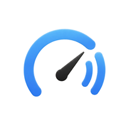
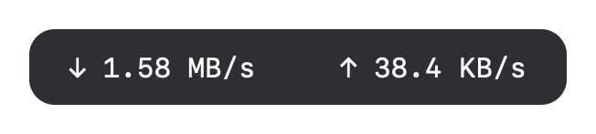

<p align="center">
  
</p>

<h1 align="center">Mac Speed</h1>

<p align="center">
  A tiny, native macOS menu bar app that shows your live network speed at a glance —<br/>
  and runs an on-demand speed test when you want one.
</p>

<p align="center">
  
  
  
  
</p>

<p align="center">
  
</p>

---

## Overview

Mac Speed sits quietly in your menu bar and shows your current download and upload
speed, side by side, updating in real time. It is written in pure Swift with AppKit,
has no third-party dependencies, and is built to be light enough to leave running
24/7 — typically a fraction of a percent of CPU and a few megabytes of memory.

It does one thing well, and it does it without watching what you do online.

## Features

- **Live menu bar readout** — download and upload speed shown horizontally, with
  monospaced digits so the numbers stay aligned and never jitter.
- **Pick what to show** — Download only, Upload only, or Both.
- **Adjustable refresh** — 1s, 2s, 5s, 10s, or 30s. Your choice is remembered.
- **Built-in speed test** — an optional, fast.com-style test that measures your real
  download and upload capacity in Mbps, in its own little window.
- **Start at Login** — optional, using the modern `SMAppService` API. Nothing to
  configure by hand in System Settings.
- **Open Activity Monitor** — one click, for when you spot a spike and want to find
  the culprit.
- **No Dock clutter** — runs as a menu bar agent with no Dock icon and no windows.

## Privacy — and why you can trust it

A network monitor only deserves your trust if it isn't quietly snooping. Mac Speed is
designed so that it *can't*:

- **It reads totals, not traffic.** Speed is measured by reading the aggregate byte
  counters macOS already keeps for each network interface, via the kernel's `sysctl`
  interface (`NET_RT_IFLIST2`). It never inspects packet contents and never sees which
  sites or apps you use.
- **Normal monitoring makes zero network connections of its own.** It only reads local
  counters. There is nothing to phone home to.
- **The speed test is the only feature that connects out — and only when you press it.**
  It transfers throwaway bytes to/from [Cloudflare's public speed-test endpoints](https://speed.cloudflare.com)
  (the download is discarded; the upload is just zeros). No personal data is sent.
- **No accounts, no analytics, no telemetry, no background activity.**
- **No special permissions.** No Accessibility, no Full Disk Access, no network
  entitlement to grant.
- **No dependencies.** Nothing is pulled in from third parties — there is no
  supply-chain code to vet.
- **It's open source.** The whole thing is a few hundred lines of readable Swift in
  [`Sources/MacSpeed`](Sources/MacSpeed). Read it, build it yourself, verify it.

## Install

### Option A — Download a build

1. Grab `Mac-Speed.zip` from the [Releases](https://github.com/maryan-nivaas/Mac-Speed/releases) page and unzip it.
2. Move **Mac Speed.app** to your `/Applications` folder.
3. The first time you open it, macOS may warn that it's from an unidentified developer.
   This is expected: the app is ad-hoc signed, not notarized through a paid Apple
   Developer account. To open it anyway, **right-click the app → Open → Open**, or run:
   ```sh
   xattr -dr com.apple.quarantine "/Applications/Mac Speed.app"
   ```

### Option B — Build from source (recommended if you want to verify it)

Requires macOS 13+ and the Swift toolchain (the Xcode Command Line Tools are enough —
no need to open Xcode).

```sh
git clone https://github.com/maryan-nivaas/Mac-Speed.git
cd Mac-Speed
./build.sh
# then move the result into place:
cp -R "Mac Speed.app" /Applications/
open "/Applications/Mac Speed.app"
```

`build.sh` compiles a release binary, assembles the `.app` bundle, attaches the icon,
and ad-hoc signs it.

## Usage

Click the readout in the menu bar to open the menu:

- **Start at Login** — toggle automatic launch at startup.
- **Show** — Download only / Upload only / Both.
- **Update Interval** — 1s / 2s / 5s / 10s / 30s.
- **Speed Test…** — opens a window that measures download, then upload, live.
- **Open Activity Monitor** — jump to Activity Monitor to investigate traffic.
- **Quit**.

## How it works

**Live monitoring.** Every interval, Mac Speed reads the cumulative in/out byte counters
for all active, non-loopback interfaces, subtracts the previous reading, and divides by
the elapsed time to get bytes per second. Units auto-scale (B/KB/MB/GB per second).

**Speed test.** The test opens several parallel connections to Cloudflare's speed-test
endpoints and measures throughput over a fixed time window, discarding a short ramp-up
period and reporting the steady-state average in Mbps. Finished streams are immediately
replaced so the link stays saturated for the whole measurement, which keeps results
close to what tools like fast.com report.

## Requirements

- macOS 13.0 (Ventura) or later
- Apple Silicon or Intel
- Swift 5.9+ toolchain (only to build from source)

## Project structure

```
Sources/MacSpeed/
  main.swift              App entry point (menu bar agent, no Dock icon)
  AppDelegate.swift       Menu bar item, menu, settings, rendering
  NetworkMonitor.swift    Reads interface byte counters via sysctl
  SpeedFormatter.swift    Human-readable, fixed-width speed strings
  SpeedTest.swift         On-demand download/upload bandwidth test
  SpeedTestWindow.swift   The speed-test results window
  LoginItem.swift         Start-at-login via SMAppService
build.sh                  Build + bundle + sign script
make-icon.swift           Generates the rounded app icon from the logo
```

## Contributing

Issues and pull requests are welcome. If you're reporting a bug, please include your
macOS version and, if relevant, your network setup (Wi-Fi vs Ethernet, VPN on/off).

## License

[MIT](LICENSE) © 2026 Maryan Nivaas
